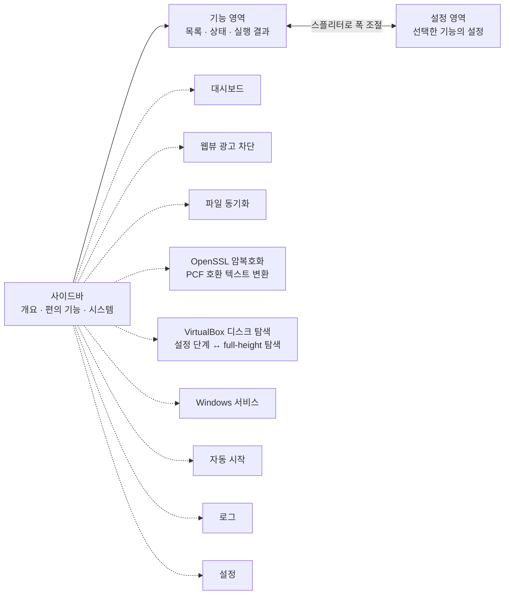
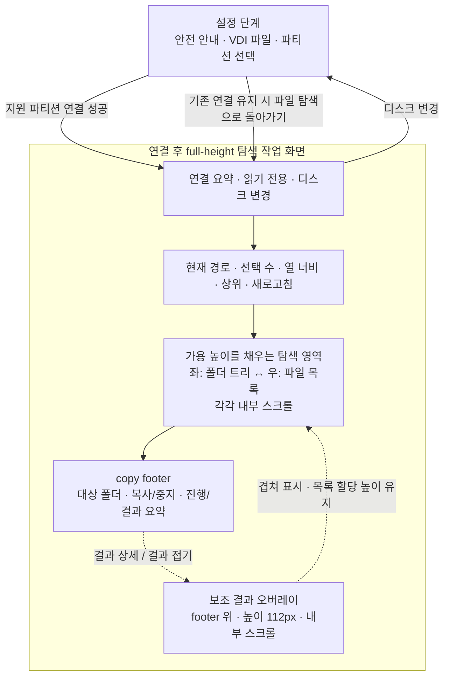
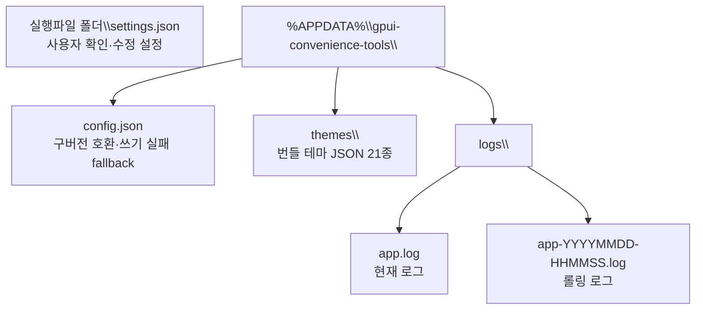
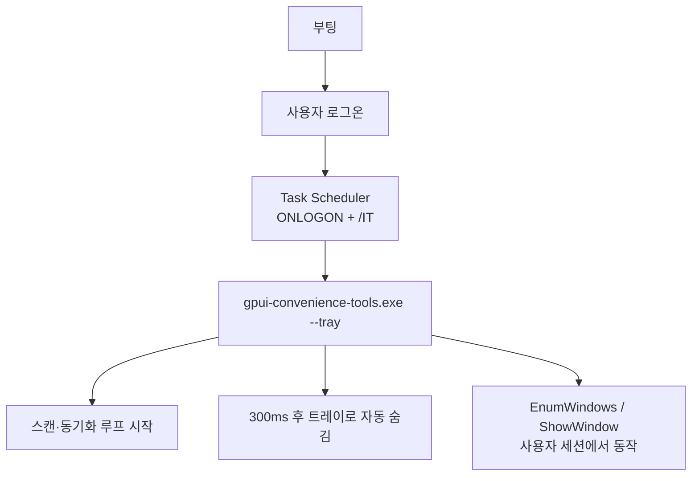

# gpui-convenience-tools

## 프로젝트 문서

문서 정본은 모두 이 `docs/` 디렉터리에 둔다. 루트에는 에이전트 진입점인 `AGENTS.md`와
`CLAUDE.md`만 남기며, 두 파일은 공통 내용을 복사하지 않고 아래 문서를 참조한다.

| 문서 | 역할 |
| --- | --- |
| [DEVELOPMENT_GUIDE.md](DEVELOPMENT_GUIDE.md) | 공통 개발·아키텍처·검증 규칙의 단일 정본 |
| [MASTER_PLAN.md](MASTER_PLAN.md) | 현재 단계와 완료 이력 진입점 |
| [PROJECT_MAP.md](PROJECT_MAP.md) | 실제 구조·줄 수·공용 유틸 지도 |
| [VERIFICATION.md](VERIFICATION.md) | E2E 사용법과 열린 작업의 검증 게이트 |
| [TODO.md](TODO.md) | 고유 작업 ID가 있는 미완료 대기열 |
| [TEST_FIXTURES.md](TEST_FIXTURES.md) | 합성 VDI fixture와 검증 데이터 계약 |
| [VIRTUAL_DISK_BACKENDS.md](VIRTUAL_DISK_BACKENDS.md) | VirtualBox 오프라인 전용 파일 접근 결정과 미채택 검토 이력 |

완료 단계 상세는 [구현 이력](IMPLEMENTATION_HISTORY.md), 지난 명령·수치·해시와 미검증
경계는 [검증 결과 기록](VERIFICATION_RECORDS.md)으로 연결한다. 기존 제목의 과거 상태를
현재 대기열로 해석하지 않는다. 작업 시작 시 위 문서를 전부 읽지 않고 관련 절만 고른다.

협업 에이전트 역할 정본은 `.github/agents/`에 있으며, Claude와 Codex 실행 환경은 각각
`.claude/agents/`와 `.codex/agents/`의 얇은 어댑터를 사용한다. 공통 역할 경계와 호출 흐름은
`DEVELOPMENT_GUIDE.md`의 「협업 에이전트」를 참조한다.

**Rust + GPUI 기반 다용도 데스크탑 보조 도구 모음.**

하나의 앱 안에 서로 독립적인 편의 기능을 패널 단위로 모아 두는 것이 이 프로젝트의 목적이다.
개별 기능이 아니라 **편의 기능을 담는 그릇**이 정체성이므로, 새 기능은 기존 기능과 얽히지 않는
독립 패널로 추가된다.

## 편의 기능

| 기능 | 설명 | 플랫폼 |
| --- | --- | --- |
| **웹뷰 광고 차단** | 카카오톡 등 WebView2 기반 앱의 확인된 광고 창을 0×0으로 축소하고 입력을 막는다. 카카오톡 기본 채팅창에는 별도 선택형 광고 자리 회수 모드(실험적)가 있다. | Windows |
| **파일 동기화** | 원본 폴더를 대상 폴더로 주기적으로 복사한다. 숨김·시스템 파일 포함. | 공통 |
| **Windows 서비스** | 설치된 Win32 서비스를 조회·시작·중지·삭제한다. | Windows |
| **VirtualBox 디스크 탐색** | 종료된 VM의 VDI를 읽기 전용으로 탐색하고 숨김·시스템 파일을 호스트로 복사한다. | Windows 1차 |
| **OpenSSL 암복호화** | PCF 호환 AES-256-CBC 텍스트를 Base64로 인코딩·디코딩한다. | 공통 |

부가 요소로 대시보드, 자동 시작 등록(작업 스케줄러), 롤링 파일 로그, 21종 테마를 제공한다.

> VirtualBox 디스크 탐색은 종료된 VM의 오프라인 VDI 1.1을 읽기 전용으로 탐색하며,
> 현재 NTFS 3.1·숨김/시스템 항목 표시·호스트 복사를 지원한다. MSR·BitLocker는
> 탐색 지원 대상이 아니며 사유를 안내한다. 구현 및 남은 검증은 `TODO.md`의 Phase O,
> 확인한 증거는 `VERIFICATION.md`를 참조한다.
> `VBoxManage` 실행 중 VM 경로 대조는 `GPUI_CONVENIENCE_TOOLS_VBOXMANAGE`로 지정한다.
> 실행 중 VM의 파일은 VDI 직접 읽기와 Guest Control 방식 모두 접근하지 않는다.
> 결정과 과거 검토 이력은 `VIRTUAL_DISK_BACKENDS.md`에 기록한다.

### 화면 구성

좌측 사이드바는 **개요 / 편의 기능 / 시스템** 세 그룹으로 나뉜다.
편의 기능은 작업 흐름에 맞춰 목록/설정 스플리터 또는 전체 너비 작업 화면을 사용한다.
파일 동기화는 단일 스크롤 페이지이고, VirtualBox 디스크 탐색은 아래와 같은 단계형 작업
화면이다. 스플리터가 있는 영역은 드래그로 폭을 조절할 수 있다.



앱 전역 설정(테마, 로그 보관)만 **설정** 페이지에 있고, 기능별 설정은 해당 기능 페이지 안에 있다.

<a id="virtualbox-workspace"></a>

### VirtualBox 탐색 작업 화면

파일 탐색에 가용 높이를 우선 배분한다. 연결 전에는 안전 안내·VDI 파일 입력/찾아보기·
파티션 선택을 설정 단계에 표시한다.
지원 파티션 연결 성공 후에는 연결 요약만 상단에 남기고 폴더 트리·파일 목록이 가용 높이를
채운다. `디스크 변경`은 기존 연결을 즉시 버리지 않고 설정 단계로 이동하며, 다른 디스크를
열지 않았다면 `파일 탐색으로 돌아가기`로 기존 탐색 상태에 복귀한다.
복사 중에는 해당 버튼이 `복사 중`으로 표시되고 설정 단계 이동을 차단한다. 긴 탐색 오류는
최대 높이 48px의 스크롤 영역으로 제한해 목록과 복사 중지 버튼을 밀어내지 않는다.



`열 너비`와 `결과 상세`는 기본 접힘이다. 조절한 열 폭은 저장되며, 복사 조작과 요약은
하단 footer에 둔다. 결과 상세는 footer 위 보조 오버레이로 표시해 목록의 할당 높이를 유지한다.
검증 기록은 [VERIFICATION.md](VERIFICATION.md#vde-026-workspace-evidence),
남은 OS 파일 선택·취소 확인은 [TODO.md](TODO.md)를 참조한다.

## 요구 사항

- Rust stable
- Windows 10/11 (광고 차단·서비스 관리는 `windows-sys` 기반이라 Windows 전용)

## 실행과 검증

```powershell
cargo run   -p gpui-convenience-tools            # 실행
cargo check -p gpui-convenience-tools            # 코드 수정 후
cargo test  -p gpui-convenience-tools -- --nocapture
cargo build -p gpui-convenience-tools --release  # 릴리즈
```

실행 플래그: `--tray`(창 없이 트레이로 시작), `--service`(SCM 서비스 디스패처 모드).

광고 창 후보를 실제로 조작하지 않고 프로세스 트리·최상위·자식 창을 확인하려면 다음 읽기
전용 진단을 사용한다. 명시적 `Chrome_WidgetWin_1` 필터는 KakaoTalk WebView 광고 자식
창 확인용이며, 결과의 `Visible=False`는 현재 화면에서 축소 동작을 판정할 수 없다는 뜻이다.

광고 자리 회수는 **웹뷰 광고 차단** 패널의 선택 옵션이며 기본값은 꺼짐이다. 카카오톡
기본 채팅창의 확인된 창 계층·크기가 맞을 때만 하단 광고 슬롯을 접고 목록 영역을 늘린다.
옵션이나 차단을 끄거나 앱을 종료하면 저장한 크기로 복원을 시도한다. 사용자 실기기 확인과
검증 범위는 [검증 결과 기록](VERIFICATION_RECORDS.md)의 `AD-006` 완료 기록을 참조한다. 이 옵션은
대화형 GUI 세션 전용이며 Session 0의 `--service` 모드에는 적용되지 않는다.

```powershell
pwsh -NoProfile -File .\scripts\Verify-AdWindowState.ps1 `
  -ProcessId 26440 -IncludeChildWindows -ClassFilter Chrome_WidgetWin_1
```

## 저장 위치

사용자가 확인·수정하는 설정은 기본적으로 실행파일 옆 `settings.json`에 저장한다. 로그·테마·실행
이력 같은 앱 데이터와 실행파일 옆 저장이 불가능한 경우의 fallback 설정은
`%APPDATA%\gpui-convenience-tools\` 아래에 둔다. `GPUI_CONVENIENCE_TOOLS_DATA_DIR`가
설정된 검증 환경에서는 해당 경로의 `settings.json`·`config.json`을 분리해 사용한다.

앱에서 바꾼 설정(밝음/어두움 색상 모드 포함)은 변경 시 저장되고 다음 실행에서 복원된다. `settings.json`이 있으면
구형 `config.json`보다 항상 우선한다. 구형 파일 끝의 여분 닫는 괄호는 읽기 시에만
복구하며 원본은 보존한다. 그 밖의 손상은 덮어쓰지 않고 오류를 기록한다. 공통 저장 규칙은
`DEVELOPMENT_GUIDE.md`의 「사용자 설정 기본 영속화」를 참조한다.



## 파일 동기화

원본 폴더의 파일을 대상 폴더로 주기적으로 복사한다. **숨김·시스템 속성 파일을 포함해
전체를 동기화**하는 것이 기본 동작이다.

- 복사 판정: 크기가 다르거나 원본이 2초 이상 최신이면 복사(내용 해시 비교는 하지 않음)
- 감시 주기: 작업별로 30초 ~ 1시간 중 선택
- 옵션: 자동 동기화 사용 / 숨김·시스템 파일·폴더 포함 / 원본에서 삭제된 항목 반영(미러 삭제)
- 제외 패턴: 설정 카드의 멀티라인 입력에 한 줄에 하나씩 상대 경로 glob을 입력한다.
  빈 줄은 저장 시 무시하며, 예를 들어 `**/*.tmp`는 모든 하위 폴더의 임시 파일을,
  `cache/**`는 `cache` 폴더와 그 하위 경로를 제외한다.
- 원본 탐색: 설정 카드에서 직계 파일·폴더를 빠르게 열거하며 숨김·시스템 항목도 항상 표시한다.
  `제외`/`제외 해제`를 누르면 해당 상대 경로가 제외 패턴에 반영된다. 폴더를 제외하면
  하위 항목 전체를 건너뛰며, 링크·정션 내부로는 탐색하지 않는다.
- 링크·정션: 기본 `건너뛰기` 외에 원본 내부 대상만 복사하는 `대상 따라가기`와 대상 폴더
  내부 상대 링크로 옮기는 `링크 재생성`을 선택할 수 있다. 원본 밖 대상·순환 링크는 경로별
  실패로 남긴다. 재생성은 Windows 관리자 권한 또는 개발자 모드가 필요할 수 있으며,
  대상에 같은 이름의 다른 링크나 일반 파일이 있으면 자동 덮어쓰지 않는다. Windows 정션은
  원본 내부 대상만 디렉터리 심볼릭 링크로 재생성한다.

### 동기화 실패 처리

복사할 수 없는 파일(사용 중·권한 부족·경로 길이 초과 등)은 **건너뛰고 사유를 남긴다**.
사유는 세 곳에 남는다.

1. **토스트 알림** — 새로 발생한 실패에 대해서만 표시
2. **로그 패널 + 롤링 로그 파일** — 항상 기록
3. **파일 동기화 패널의 실패 목록** — 경로별 사유

같은 파일에서 같은 사유가 반복될 때 알림이 계속 뜨는 것을 막기 위해 두 가지 억제 수단이 있다.

- 실패 항목별 **`알림 끄기`** 버튼 — 해당 항목의 토스트만 끈다(로그에는 계속 기록)
- **`실패 알림 표시`** 스위치 — 동기화 실패 토스트 전체를 끈다

이미 목록에 있는 실패는 다시 토스트를 띄우지 않으므로, 매 주기마다 같은 알림이 반복되지 않는다.

## OpenSSL 암복호화 — PCF 호환

사이드바 **편의 기능 → OpenSSL 암복호화**에서 암호 문구를 확인하고 입력란에 평문 또는
Base64 암호문을 붙여 넣는다. **인코딩 (암호화)** / **디코딩 (복호화)**을 누른 뒤 결과를
선택해 `Ctrl+C`로 복사한다. 결과는 편집 가능하며 **작업 텍스트 지우기**는 입력·결과만 지운다.

- 암호 문구 기본값은 `911`, **인코딩 시 끝에 LF 추가**는 기본 켜짐이다. 켜면 기존 개행
  유무와 관계없이 LF 하나를 추가한다(Linux `echo`/PCF 호환). 디코딩은 끝의 CR/LF만 제거한다.
- 암호 문구와 LF 옵션은 변경 시 `settings.json`에 자동 저장되고 다음 실행에서 복원된다.
  암호 문구 위젯은 기본 마스킹·표시 토글을 제공하지만 **파일에는 평문 저장**된다.
  저장 경로와 격리 설정은 위 「저장 위치」를 따른다. 작업 텍스트 지우기는 저장된 암호 문구를 지우지 않는다.
- 입력·결과는 앱 메모리에만 두고 설정·로그에 기록하지 않는다. 암호 문구도 로그에 기록하지
  않는다. 사용자가 결과를 복사하면 클립보드에는 남을 수 있다.
- 평문은 UTF-8 기준 32 KiB, Base64 입력은 공백 포함 64 KiB까지다. 암호 문구 UI 입력은
  1,024바이트, 코덱 내부 한도는 32 KiB다. OpenSSL 설치나 외부 프로세스 실행은 필요 없다.

호환 형식은 `Base64(Salted__ + 무작위 8바이트 salt + AES-256-CBC 암호문)`이며 PKCS#7,
`EVP_BytesToKey` 1회 반복을 사용한다. 인코딩은 SHA-256, 디코딩은 SHA-256 후 MD5를 시도한다.
매번 salt가 달라 같은 입력도 암호문은 달라진다. **인증 없는 레거시 호환 형식**이므로
복호화 성공만으로 암호 문구의 정확성·위변조 여부를 보장하지 않으며 새 보안 설계용이 아니다.
구현 단계는 [SSL-001 이력](IMPLEMENTATION_HISTORY.md#ssl001-implementation-stage),
최종 검증·남은 게이트는 [VERIFICATION.md](VERIFICATION.md)를 참조한다.

## 로그

콘솔과 파일에 동시에 기록하며, 파일은 세 가지 보존 기준을 함께 적용한다.
**설정 → 로그 파일 보관**에서 변경하며, 변경 즉시 반영된다.

| 기준 | 설정값 | 동작 |
| --- | --- | --- |
| 파일 개수 | 3 / 5 / 10 / 20 / 50개 | 현재 파일 포함 개수 초과 시 오래된 순 삭제 |
| 보관 기간 | 제한 없음 / 7 / 14 / 30 / 90일 | 기준보다 오래된 파일 삭제 |
| 파일 용량 | 1 / 5 / 10 / 50 / 100 MB | 초과 시 타임스탬프 이름으로 롤링 |

콘솔 출력 레벨은 `RUST_LOG` 환경변수로 조정한다(기본 `info`).
파일에는 `Debug` 레벨까지 기록된다 — GPUI가 프레임마다 남기는 `Trace` 로그가 파일을 가득 채워
실제 앱 로그를 밀어내기 때문이다. `RUST_LOG=trace`를 지정하면 파일 상한도 함께 올라간다.

## 관리자 권한

Windows 서비스 시작·중지·삭제에는 관리자 권한이 필요하다.
앱은 실행 시 권한을 확인해 **Windows 서비스** 페이지 우측에 현재 권한 상태를 표시한다.
앱은 자동으로 UAC 승격하지 않으며, 관리자 권한이 필요한 작업은 사용자가 앱을
**관리자 권한으로 직접 실행**해야 한다.

### 매니페스트 제약

`gpui`의 `windows-manifest` 피처가 이미 `RT_MANIFEST(ID=1)`을 임베드하기 때문에,
`winres` / `embed-resource`로 매니페스트를 추가하면 `CVT1100` / `LNK1123` 중복 리소스 오류가 난다.
`gpui`에 `default-features = false`를 지정해도 `gpui-component`가 기본 피처로 다시 켜므로 효과가 없다.
그래서 `build.rs`는 `/MANIFEST:NO`만 지정하고 자체 매니페스트 임베딩을 하지 않는다.
과거의 미사용 `app/resources.rc`와 UAC 매니페스트 파일은 제거했으며, 이 정책을 다시
바꾸려면 먼저 gpui의 매니페스트 리소스 충돌과 배포 검증을 별도 작업으로 확인한다.

## 자동 시작 (작업 스케줄러)

Windows 서비스(SCM)는 Session 0(비대화형)에서 실행되어 사용자 세션의 창을
`EnumWindows` / `ShowWindow`로 조작할 수 없다(**Session 0 격리**).
이 문제를 피하기 위해 자동 시작은 **작업 스케줄러**를 사용한다.



앱 내 **자동 시작** 페이지에서 등록/삭제/즉시 실행이 가능하다. CLI로 직접 관리하려면:

```powershell
schtasks /Create /TN "gpui-convenience-tools" /TR '\"<설치경로>\gpui-convenience-tools.exe\" --tray' /SC ONLOGON /IT /F
schtasks /Delete /TN "gpui-convenience-tools" /F
schtasks /Run    /TN "gpui-convenience-tools"
```

## 관리자 권한 디버깅 (VS Code)

- **방법 1** — VS Code를 관리자 권한으로 실행한 뒤 `Debug gpui-convenience-tools (Admin)` 구성 사용.
  부모 프로세스가 관리자이면 자식(디버그 exe)도 관리자 권한으로 실행된다.
- **방법 2** — 관리자 터미널에서 `target\debug\gpui-convenience-tools.exe`를 직접 실행하고,
  `Attach to gpui-convenience-tools` 구성으로 attach.

## 설치 파일 만들기

### Windows (MSI)

WiX Toolset(v3) 설치 후:

```powershell
.\installer\windows\build-installer.ps1
```

결과: `installer/windows/gpui-convenience-tools.msi`

### macOS (앱 번들 · DMG)

macOS에서:

```bash
bash installer/macos/build-app.sh
```

결과: `target/macos/gpui-convenience-tools.app`, `target/macos/gpui-convenience-tools-<버전>-universal.dmg`
(Apple Silicon·Intel 유니버설 바이너리)

## 릴리즈 (CI / CD)

- **`windows-build.yml`** — `main`/`master` push 및 PR에서 `cargo check` → `cargo test` → 릴리즈 빌드
- **`macos-build.yml`** — 같은 트리거로 macOS에서 `cargo check` → `cargo test` → 앱 번들·DMG 패키징
- **`release.yml`** — `v*` 태그 push 시 Windows와 macOS를 각각 빌드해 **하나의 GitHub Release**에 첨부

```bash
git tag v1.0.0
git push origin v1.0.0
```

두 플랫폼 빌드가 모두 성공해야 릴리즈가 만들어진다. 릴리즈 에셋은 다음과 같다.

| 플랫폼 | 파일 | 비고 |
| --- | --- | --- |
| Windows | `gpui-convenience-tools.msi` | 설치 관리자 (권장) |
| Windows | `gpui-convenience-tools.exe` | 단일 실행 파일 |
| macOS | `gpui-convenience-tools-<버전>-universal.dmg` | Apple Silicon · Intel 공용 |

### macOS 첫 실행 (중요)

코드 서명·공증(notarization)을 하지 않은 빌드이므로 그냥 열면 Gatekeeper가 차단한다.
앱을 `응용 프로그램`으로 옮긴 뒤 **한 번만** 아래 중 하나를 수행한다.

- Finder에서 앱을 **우클릭 → 열기 → 열기**
- 또는 터미널에서:

  ```bash
  xattr -dr com.apple.quarantine /Applications/gpui-convenience-tools.app
  ```

### macOS 지원 범위

macOS 공통 메뉴에는 **파일 동기화·VirtualBox 디스크 탐색·OpenSSL 암복호화**와 테마·로그·설정이 포함된다.
이번 OpenSSL 실행 검증은 Windows에서만 수행했으며 macOS 빌드·실제 화면은 미검증이다.
웹뷰 광고 차단·Windows 서비스 관리·자동 시작은 Win32/SCM 전용이라 해당 메뉴가 노출되지 않는다.
